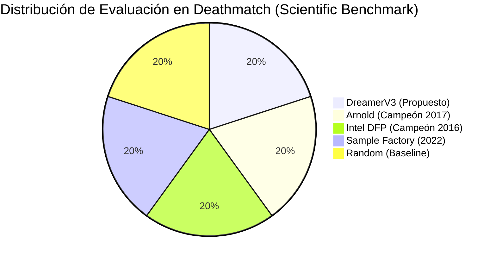

# 🎮 doom-agent

Plataforma integral de experimentación y benchmarking de **Aprendizaje por Refuerzo Profundo (DRL)** sobre el simulador [ViZDoom](file:///home/darkstar/Workspace/ai/rl/doom-agent/src/doom_agent/scenarios). El proyecto abarca desde métodos clásicos libres de modelo (DQN, A2C, PPO) hasta arquitecturas de vanguardia basadas en modelos de mundo (**World Models / DreamerV3**) y aprendizaje por imitación (**Behavior Cloning**).

[](https://www.python.org/)
[](https://pytorch.org/)
[](https://vizdoom.farama.org/)
[](https://hydra.cc/)
[](https://wandb.ai/)

---

## 📑 Índice de Documentación

Para una inmersión detallada en los diferentes aspectos del proyecto, consulta los módulos especializados:

- 🏛️ **[Arquitectura de Software y Principios SOLID](file:///home/darkstar/Workspace/ai/rl/doom-agent/docs/ARCHITECTURE.md)**: Estructura del código, patrones de diseño, flujo de datos y diagramas de secuencia.
- 🔬 **[Benchmarking Científico y Baselines SOTA](file:///home/darkstar/Workspace/ai/rl/doom-agent/docs/BENCHMARKS.md)**: Comparativas reproducibles frente a campeones históricos (*Arnold 2017*, *Intel DFP 2016*, *Sample Factory 2022*).
- ⚡ **[Guía de Entrenamiento y Perfiles de Hardware](file:///home/darkstar/Workspace/ai/rl/doom-agent/docs/HARDWARE_AND_TRAINING.md)**: Despliegue en GPUs locales (*RTX 3060/5090/6000 Ada*) o instancias de nube (*NVIDIA H200*).
- 🧠 **[Fundamentos Teóricos y Matemáticos](file:///home/darkstar/Workspace/ai/rl/doom-agent/src/doom_agent/algorithms/dreamer/v3/THEORY.md)**: Derivación del RSSM, SymLog scaling e Imitation Learning (Behavior Cloning).
- 📊 **[Resultados Experimentales](file:///home/darkstar/Workspace/ai/rl/doom-agent/RESULTS.md)**: Historial de ejecuciones, recompensas alcanzadas y métricas de combate.

---

## 🚀 Inicio Rápido (Quickstart)

### 1. Instalación de Dependencias

```bash
# Clonar e inicializar entorno virtual
python -m venv venv
source venv/bin/activate

# Instalar dependencias esenciales
pip install -r requirements_cloud.txt
```

### 2. Exportar la Raíz del Código

```bash
export PYTHONPATH="$(pwd)/src:$(pwd)"
```

### 3. Entrenar el Agente SOTA (DreamerV3)

```bash
# Lanzar entrenamiento en escenario deathmatch con perfil para GPU local
python src/doom_agent/algorithms/dreamer/v3/train.py \
  scenario=deathmatch \
  hardware=rtx3060 \
  wandb.enabled=false \
  device=cuda
```

### 4. Probar Incentivos con el Validador de Recompensas

Prueba la física de recompensas en tiempo real controlando manualmente al agente antes de comenzar entrenamientos costosos:

```bash
# Modo manual interactivo (W/A/S/D + mouse/espacio)
python scripts/test_reward_shaping.py --manual

# Modo espectador sobre un agente entrenado
python scripts/test_reward_shaping.py --agent_run <RUN_ID>
```

---

## 🤖 Catálogo de Algoritmos Implementados

| Algoritmo | Familia | Ubicación en el Repositorio | Descripción / Estado |
|---|---|---|---|
| **DreamerV3** | Model-Based RL | [src/doom_agent/algorithms/dreamer/v3](file:///home/darkstar/Workspace/ai/rl/doom-agent/src/doom_agent/algorithms/dreamer/v3) | **Agente insignia**. Aprendizaje en espacio latente (*RSSM*), aumentación simétrica y currículo adaptativo. |
| **PPO (v1 - v5)** | Policy Gradient | [src/doom_agent/algorithms/ppo](file:///home/darkstar/Workspace/ai/rl/doom-agent/src/doom_agent/algorithms/ppo) | Baselines basados en Stable-Baselines3. PPO v5 implementa currículo de habilidades en *Deadly Corridor*. |
| **DQN / DDDQN** | Value-Based | [src/doom_agent/algorithms/dqn](file:///home/darkstar/Workspace/ai/rl/doom-agent/src/doom_agent/algorithms/dqn) | Deep Q-Networks con extensiones Dueling y Double DQN sobre frames preprocesados. |
| **A2C / A3C** | Actor-Critic | [src/doom_agent/algorithms/a2c](file:///home/darkstar/Workspace/ai/rl/doom-agent/src/doom_agent/algorithms/a2c), [a3c](file:///home/darkstar/Workspace/ai/rl/doom-agent/src/doom_agent/algorithms/a3c) | Implementaciones sincrónicas y asincrónicas en entornos de acción continua y discreta. |
| **DDPG** | Deterministic Policy | [src/doom_agent/algorithms/ddpg](file:///home/darkstar/Workspace/ai/rl/doom-agent/src/doom_agent/algorithms/ddpg) | Variante para espacios de acción continua con red crítica profunda. |

---

## 🏆 Suite de Benchmarking SOTA

El proyecto incluye adaptadores para enfrentar a DreamerV3 contra los mayores referentes competitivos de ViZDoom:



Para reproducir la evaluación científica estandarizada:
```bash
python scripts/run_scientific_benchmark.py
```
Consulta la guía completa en [docs/BENCHMARKS.md](file:///home/darkstar/Workspace/ai/rl/doom-agent/docs/BENCHMARKS.md).

---

## 📂 Estructura del Repositorio

```
doom-agent/
├── src/doom_agent/
│   ├── algorithms/       # Algoritmos RL modulares (dreamer/v3, ppo, dqn, a2c, ddpg)
│   ├── common/           # Redes neuronales comunes, monitores de SB3 y métricas
│   ├── data/             # OfflineDoomDataset para Behavior Cloning (.npz)
│   ├── scenarios/        # Archivos de configuración (.cfg) y mapas (.wad) de ViZDoom
│   ├── utils/            # Memoria de experiencia, schedulers lineales y utilidades
│   └── wrappers/         # Wrappers de entorno (DoomDreamerEnv, Gym wrappers)
├── docs/                 # Documentación técnica, papers y esquemas arquitectónicos
│   ├── ARCHITECTURE.md   # Arquitectura de software y principios de diseño
│   ├── BENCHMARKS.md     # Comparativas y metodología de evaluación SOTA
│   └── HARDWARE_AND_TRAINING.md # Guía de aceleración por GPU y computación cloud
├── scripts/              # Herramientas de benchmarking, adaptadores y validación
├── external/             # Modelos preentrenados y código fuente de Arnold y DFP
├── results/              # Manifiestos de corridas, métricas y gráficas exportadas
└── tests/                # Pruebas automatizadas y suites de verificación
```

---

## 📜 Licencia y Referencias

El código de este repositorio está desarrollado bajo fines de investigación académica en Inteligencia Artificial y Aprendizaje por Refuerzo.

### Citas Relevantes
- **DreamerV3**: Hafner et al. (2023) *Mastering Diverse Domains through World Models*.
- **Arnold**: Lample & Chaplot (2017) *Playing FPS Games with Deep Reinforcement Learning*.
- **Direct Future Prediction**: Dosovitskiy & Koltun (2016) *Learning to Act by Predicting the Future*.
