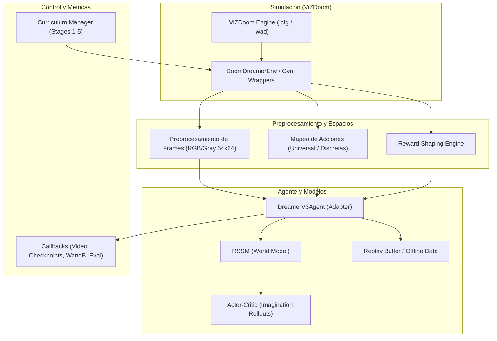
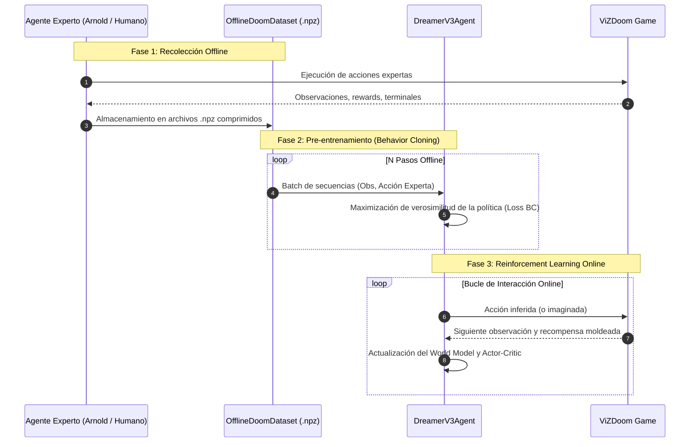

# 🏛️ Arquitectura del Sistema: doom-agent

Este documento detalla la arquitectura de software, los patrones de diseño y el flujo de datos del ecosistema [doom-agent](file:///home/darkstar/Workspace/ai/rl/doom-agent/README.md).

---

## 1. Visión General y Filosofía de Diseño

El sistema está diseñado bajo principios **SOLID** y una arquitectura en capas desacopladas, lo que permite intercambiar motores de aprendizaje (model-free vs. model-based), escenarios de simulación y baselines de benchmarking sin modificar el bucle de ejecución central.

---

## 2. Componentes Principales

### 2.1. Capa de Simulación y Entorno

- **[DoomDreamerEnv](file:///home/darkstar/Workspace/ai/rl/doom-agent/src/doom_agent/algorithms/dreamer/v3/doom_envs.py#L125)**:
  Envuelve la API de bajo nivel `vizdoom.DoomGame` para satisfacer los requerimientos de DreamerV3.
  - **Preprocesamiento**: Convierte frames de ViZDoom a resoluciones consistentes ($64 \times 64 \times 3$ o $64 \times 64 \times 1$) utilizando OpenCV con transposición de canales robusta (`robust_transpose`).
  - **Frame Skipping**: Soporta saltos configurables (típicamente 4 frames) acumulando o preservando la física del juego.
  - **Reward Shaping**: Modula la recompensa bruta con penalizaciones por pérdida de salud (`health_penalty`), gasto excesivo de munición (`ammo_penalty`), bonos por eliminación (`frag_bonus`) e incentivos de desplazamiento espacial (`movement_reward`).
- **Espacio de Acciones Universal ([universal_actions](file:///home/darkstar/Workspace/ai/rl/doom-agent/src/doom_agent/algorithms/dreamer/v3/doom_envs.py#L102))**:
  Conjunto unificado de botones que cubre movimiento hacia adelante/atrás, giros, desplazamientos laterales y ataque combinado, facilitando la transferencia de políticas entre escenarios dispares (*deadly corridor*, *defend the center*, *deathmatch*).
- **Simetría Horizontal (*Mirror Learning*)**:
  A través de la función [flip_actions](file:///home/darkstar/Workspace/ai/rl/doom-agent/src/doom_agent/algorithms/dreamer/v3/train.py#L58), los frames invertidos horizontalmente se asocian a sus acciones simétricas inversas (por ejemplo, girar a la izquierda pasa a ser girar a la derecha), duplicando la eficiencia de muestras sin coste computacional en simulación.

---

### 2.2. Capa de Modelado y Aprendizaje (DreamerV3)

El agente está encapsulado en [DreamerV3Agent](file:///home/darkstar/Workspace/ai/rl/doom-agent/src/doom_agent/algorithms/dreamer/v3/agent.py#L61) adaptando la implementación `nm512_dreamer`:

- **RSSM (Recurrent State-Space Model)**:
  Mantiene un estado determinista $h_t$ (mediante un GRU) y un estado estocástico $z_t$ (32 distribuciones categóricas de 32 clases). La discretización previene el colapso de representación y estabiliza el modelo frente a ruido visual en texturas de Doom.
- **Escalado SymLog**:
  Transforma observaciones y señales de recompensa dispares mediantes escalado bi-logarítmico $\text{symlog}(x) = \text{sign}(x) \ln(|x| + 1)$, eliminando la necesidad de normalización ad-hoc de recompensas.
- **Entrenamiento en Imaginación**:
  El par Actor-Crítico no aprende interactuando exclusivamente con el simulador, sino proyectando trayectorias latentes de $\approx 15$ pasos hacia el futuro sobre el World Model entrenado.

---

### 2.3. Sistema de Currículo Progresivo

Definido en [curriculum.py](file:///home/darkstar/Workspace/ai/rl/doom-agent/src/doom_agent/algorithms/dreamer/v3/curriculum.py):

- **[Stage](file:///home/darkstar/Workspace/ai/rl/doom-agent/src/doom_agent/algorithms/dreamer/v3/curriculum.py#L13)**: Modela una etapa pedagógica con dificultad `doom_skill` (1-5), configuración de timesteps, penalizaciones de salud/munición y un umbral opcional `target_reward`.
- **[Curriculum](file:///home/darkstar/Workspace/ai/rl/doom-agent/src/doom_agent/algorithms/dreamer/v3/curriculum.py#L33)**: Orquesta la progresión a través de etapas (por ejemplo, [DEATHMATCH_CURRICULUM](file:///home/darkstar/Workspace/ai/rl/doom-agent/src/doom_agent/algorithms/dreamer/v3/curriculum.py#L44)):
  1. `skill2_warmup`: Dificultad baja, exploración libre y fijación del World Model.
  2. `skill3_intermediate`: Penalización de hambre leve y mayor agresividad de bots.
  3. `skill4_advanced`: Penalizaciones severas por consumo ineficiente de recursos.
  4. `skill5_expert`: Velocidad máxima, esquiva y combate a muerte contra bots expertos.

---

### 2.4. Flujo de Imitación y Behavior Cloning (Offline RL)

Para resolver el problema del inicio en frío (*cold start*) en escenarios abiertos:

El módulo [OfflineDoomDataset](file:///home/darkstar/Workspace/ai/rl/doom-agent/src/doom_agent/data/dataset.py#L9) proporciona un `IterableDataset` de PyTorch que lee secuencias temporales completas desde el disco de forma eficiente sin saturar la RAM.

---

## 3. Patrones de Diseño de Software Aplicados

1. **Adapter Pattern**:
   - [DreamerV3Agent](file:///home/darkstar/Workspace/ai/rl/doom-agent/src/doom_agent/algorithms/dreamer/v3/agent.py#L61) adapta la API externa de NM512 al estándar del proyecto.
   - [ArnoldAdapter](file:///home/darkstar/Workspace/ai/rl/doom-agent/scripts/arnold_adapter.py), [DFPAdapter](file:///home/darkstar/Workspace/ai/rl/doom-agent/scripts/dfp_adapter.py) y [SampleFactoryAdapter](file:///home/darkstar/Workspace/ai/rl/doom-agent/scripts/sf_adapter.py) normalizan agentes heredados y frameworks externos para que compartan la interfaz común de inferencia `act(obs) -> action`.
2. **Strategy Pattern**:
   - Los conjuntos de botones y acciones ([get_action_set](file:///home/darkstar/Workspace/ai/rl/doom-agent/src/doom_agent/algorithms/dreamer/v3/train.py#L45)) se seleccionan dinámicamente según el escenario activo (*deadly corridor*, *defend the center*, *deathmatch*).
3. **Observer / Callback Pattern**:
   - Los callbacks desacoplados en [src/doom_agent/algorithms/dreamer/v3/callbacks](file:///home/darkstar/Workspace/ai/rl/doom-agent/src/doom_agent/algorithms/dreamer/v3/callbacks) gestionan checkpoints, evaluación periódica, volcado de vídeos reales y renderizado de vídeos imaginados por el World Model sin contaminar el bucle principal.
